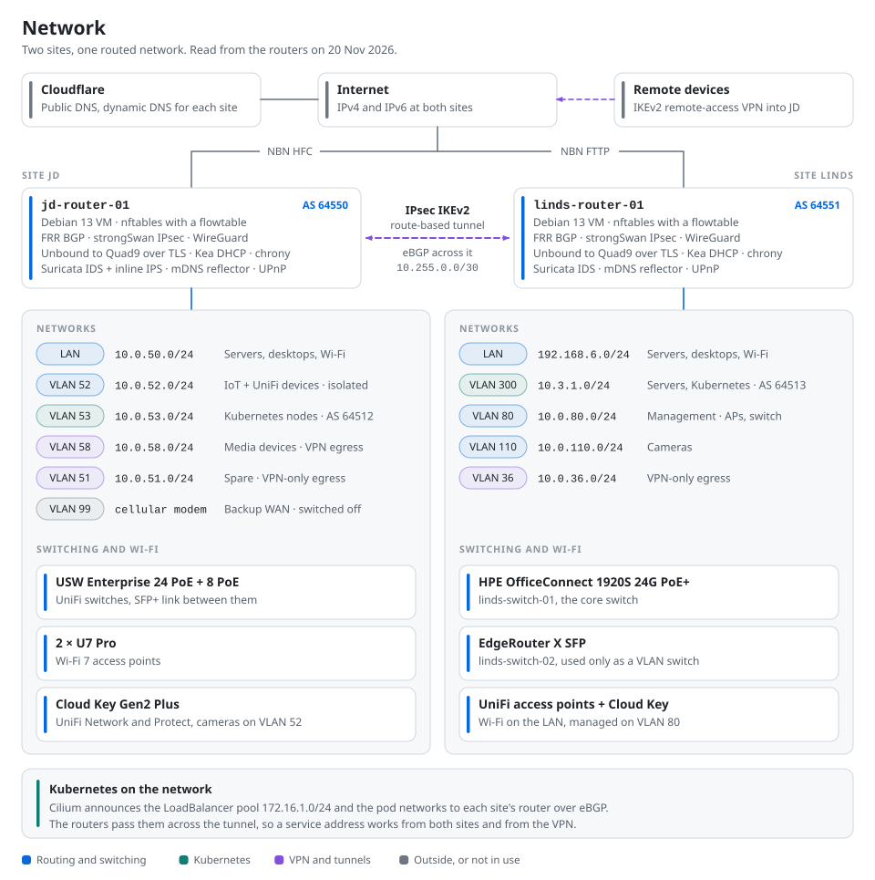
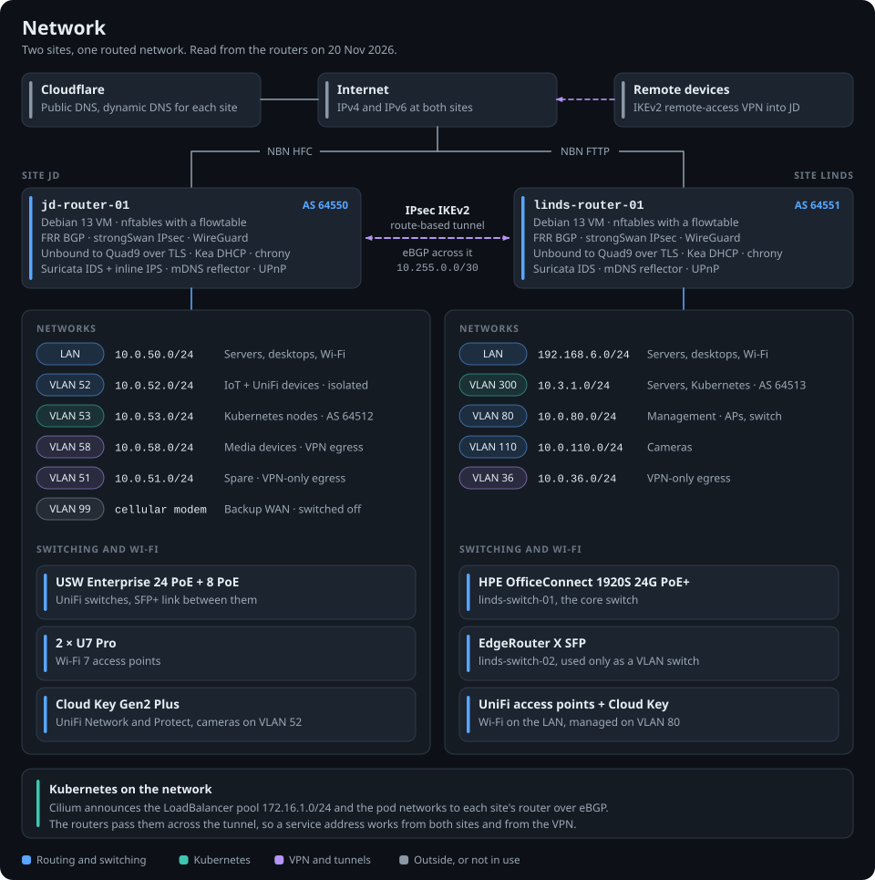
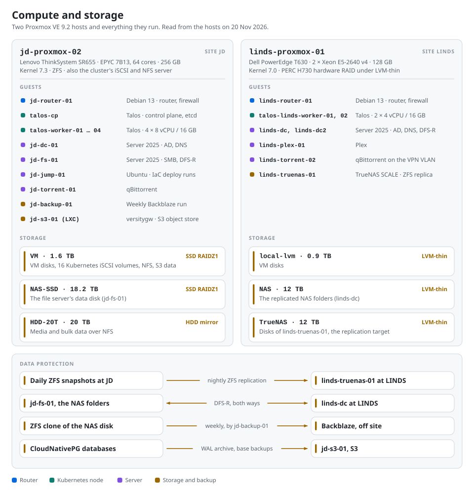
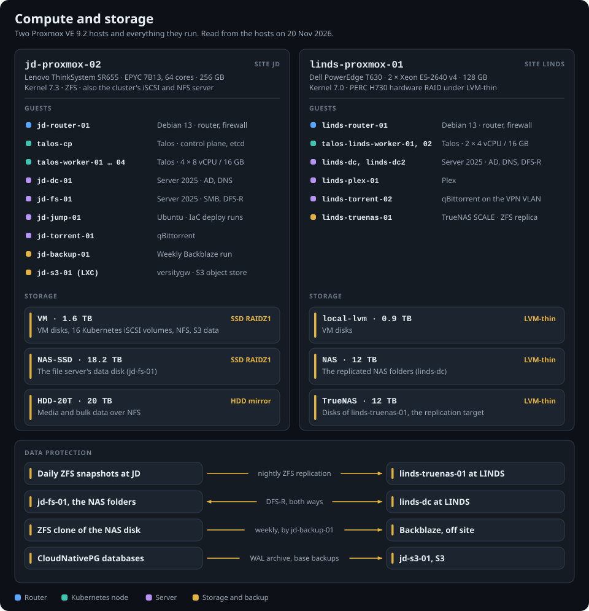
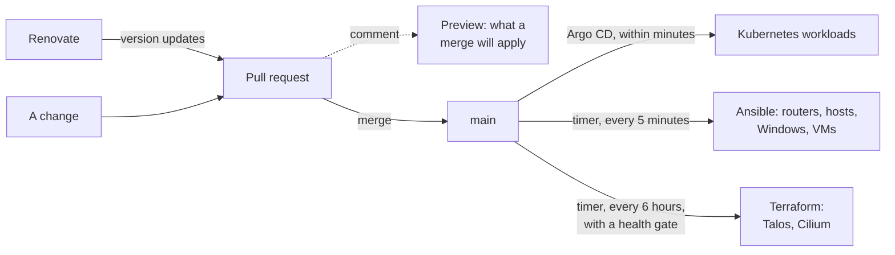
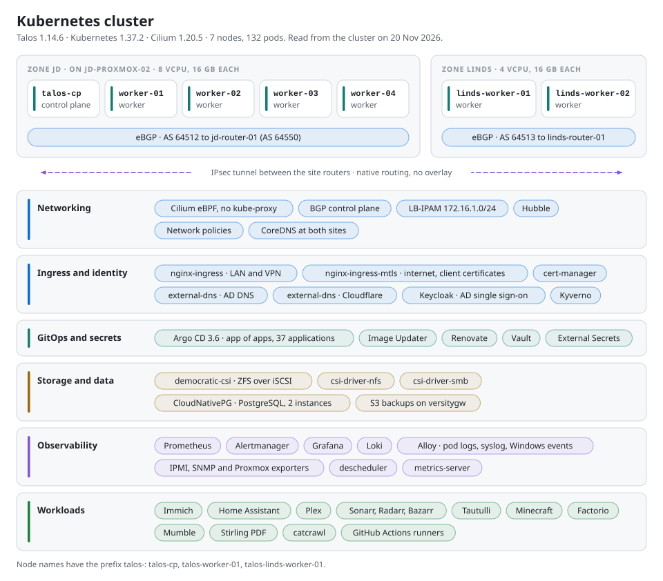
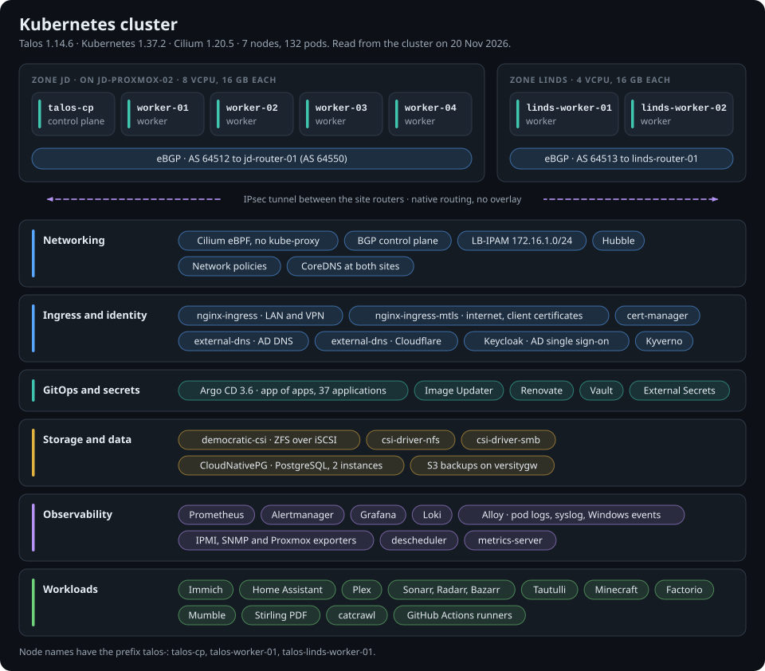

In [March]() I wrote about rebuilding the homelab on Proxmox, Talos and Cilium. Since then both routers have been replaced, the storage layer has moved, Zabbix is gone, the Windows servers are built from code, and a merge to `main` now deploys itself.

This post covers what changed between March and November 2026, and why. The diagrams are drawn from the live state of the lab on 20 November.

---

## The Network Today

{: .light }
{: .dark }

Two sites, JD and LINDS, each with one Proxmox host, one router VM and a handful of VLANs. The routers hold an IKEv2 tunnel between them and exchange routes over BGP, so the two sites behave as one routed network. The Kubernetes cluster sits on top of that and spans both.

---

## Routers: VyOS Out, Plain Debian In

The biggest change. Both sites now run a **Debian 13** VM as the router: `jd-router-01` first, then `linds-router-01` on 6 November. The VyOS role is deleted from the Ansible repo.

VyOS did the job, but three things pushed me off it: its kernel was older than I wanted, some strongSwan options I needed were not available through its configuration, and I wanted UPnP back. On plain Debian the routers run the tools directly, from Debian packages, with their own config files in Git:

- **systemd-networkd** for interfaces, VLANs and WireGuard
- **nftables** with a flowtable for the firewall and NAT
- **FRR** for BGP to the cluster and to the other site
- **strongSwan** for the site-to-site tunnel and the remote-access VPN
- **Unbound** forwarding to Quad9 over DNS over TLS, **Kea** for DHCP with dynamic DNS, **chrony** for NTP
- **Suricata** on WAN traffic, plus a second inline instance at JD that can block new connections to the published ports
- **avahi** as an mDNS reflector, so AirPlay, Cast and HomeKit work across VLANs while the IoT devices stay isolated
- **miniupnpd** for UPnP, so consoles and games can open their own ports

One Ansible role builds both routers. The site differences are a few files and feature switches. A `router` command on the box answers the usual questions (tunnel, BGP, DNS, DHCP leases, what Suricata blocked), and both routers export metrics to Prometheus with a Grafana dashboard.

**Challenges:** A router replacement at a site I am not at is a one-shot job. The LINDS cutover was built and tested on a scratch VM first, with the full ruleset run in a network namespace, and a backup of the old VM was the way back. Suricata was noisy out of the box, about 5,200 alerts a day at JD. After tuning the rule sets it is about 25, few enough to read.

**Learning:** One default can matter a lot. With hardware GRO off on the router's virtio NIC, the host cuts every TCP packet into 1500-byte frames before the router gets it. Turning it on took one routed flow between two VLANs at JD from about 330 MB/s to 1.5 GB/s.

---

## Storage: From a TrueNAS VM to ZFS on the Host

In March the cluster's storage came from a TrueNAS VM. Now the JD Proxmox host owns the ZFS pools directly and is the storage server for the cluster:

- **[democratic-csi](https://github.com/democratic-csi/democratic-csi)** creates a ZFS volume for each persistent volume claim and exports it over iSCSI from the host. Prometheus, Loki, PostgreSQL, Home Assistant and the media apps all moved onto it.
- **NFS** from the host for shared and bulk data.
- **[versitygw](https://github.com/versity/versitygw)** in an LXC replaced MinIO for S3. It stores objects as plain files on ZFS. Terraform state, PostgreSQL backups and Loki chunks live there.

TrueNAS still runs at LINDS, as the target of the nightly ZFS replication.

{: .light }
{: .dark }

**Challenges:** iSCSI volumes sometimes lost their last writes when a pod stopped. The cause was two mount propagation settings in the CSI node plugin: a filesystem could still be mounted when the iSCSI session logged out. The fix was small. Finding it was not.

**Learning:** One less layer is worth a lot. With the pools on the host, snapshots, replication and monitoring are plain ZFS.

---

## Monitoring: Goodbye Zabbix

I have run Zabbix since 2022. In October I removed it. Everything it watched now goes through the Prometheus stack that was already in the cluster:

- IPMI, SNMP and the Proxmox API through exporters, for the hosts, the BMCs and the switches
- The routers: node, FRR and smokeping exporters
- Storage health: ZFS, SMART and the RAID controller, with alerts to Discord
- Logs in Loki: pod logs, syslog from the network gear, and the Windows event logs through Grafana Alloy

**Learning:** One alerting path is easier to trust than two. An alert is now a rule in Git, and a noisy one gets fixed in a pull request, not muted in a UI.

---

## The Windows Servers Are Code Now

The domain controllers and the file server were the last hand-built machines. They are now clones of a Packer-built **Windows Server 2025** template, created by Terraform and configured by one idempotent Ansible playbook: promotion, the directory (OUs, groups, GPOs), DNS records, DFS Replication and the NTFS permission model on the NAS folders.

All four servers were rebuilt this way: two DCs at LINDS, one DC and the file server at JD. The old VMs are still there, stopped.

**Challenges:** Active Directory remembers everything. Rebuilding a DC that is also the certificate authority and a replication member has an order, and replication is slow to forgive: one rejoin took 33 hours.

---

## Merge-to-Deploy

In March I wrote that rebuilding anything was "a `terraform apply` and `ansible-playbook` away". That was true, and it was also the problem: someone had to run them. Now nobody does.

- **Kubernetes:** Argo CD, as before.
- **Ansible:** a timer on the jump box applies `main` to the hosts within about five minutes of a merge.
- **Terraform:** Talos and Cilium changes apply every six hours, and only while the cluster is healthy.
- **Previews:** each pull request gets a comment that shows what a merge will change on the real hosts.
- **Renovate** watches all three repos. Of the 512 pull requests merged since August, 235 were Renovate keeping charts, images and providers current.

A lot of the other 277 were written with [Claude Code](https://claude.com/claude-code). It has SSH access to the lab, reads the live state, makes the change in a branch and opens the pull request. I review and merge. The previews and the deploy timers exist because of that way of working: the review is the control point, so the review has to show what will really happen.

**Learning:** The useful question stopped being "is it in Git?" and became "does the box match Git?". A drift check that reports zero changes is the definition of done.

---

## The Cluster

{: .light }
{: .dark }

| | March | November |
|---|---|---|
| Nodes | 6 | 7 (a fourth worker at JD) |
| Talos | 1.13.2 | 1.14.6 |
| Kubernetes | 1.36.0 | 1.37.2 |
| Cilium | 1.19 | 1.20.5 |
| Argo CD applications | - | 37 |

What changed around it:

- **Publishing a service is an annotation.** A `LoadBalancer` Service or an Ingress with the `public.linds.com.au/*` annotations gets a port forward on the router and a DNS name in Cloudflare. Nothing is public without them. The [runbook](https://github.com/Jayden-Lind/LINDS-Kubernetes/blob/master/docs/publish-a-service.md) is one page.
- **Public web apps need a client certificate.** A second ingress controller serves only mTLS. Kyverno makes the mTLS copy of an Ingress, cert-manager issues the client certificates.
- **Single sign-on:** Keycloak in front of the apps, with users and groups read from Active Directory.
- **Network policies** on every workload that the internet can reach.
- **An internal PKI:** cert-manager also issues certificates for the things outside the cluster, such as the BMCs and the switches.
- **Workloads:** the media stack was split into separate deployments, Immich got job workers at both sites, a Minecraft server arrived, and Valheim retired.

---

## Hardening

A few changes that are not visible in a diagram:

- The Ubuntu VM template is a Packer build with 382 packages and 14 running services. No snapd, no cron, no polkit.
- The Windows servers lost 13 services and two features that a server VM does not use.
- SSH on the routers is key-only, and they accept IPv6 from the WAN only on listed ports.
- Heavy jobs (scrubs, parity checks, the weekly backup) moved into daylight hours, when the solar panels pay for them.

---

## March's "What's Next", Scored

- **Cluster API:** not started. With seven nodes that rarely change, the need has not come up.
- **Tighter network segmentation:** partly. IoT has its own isolated VLAN, and the internet-facing workloads have Cilium network policies. The main LAN is still one flat network.
- **Hubble dashboards:** the Cilium dashboards are in Grafana.

---

The updated diagrams and the full inventory are on the [Homelab page](/homelab/). Everything in this post is in the three repos: [LINDS-Terraform](https://github.com/Jayden-Lind/LINDS-Terraform), [LINDS-Ansible](https://github.com/Jayden-Lind/LINDS-Ansible) and [LINDS-Kubernetes](https://github.com/Jayden-Lind/LINDS-Kubernetes).
