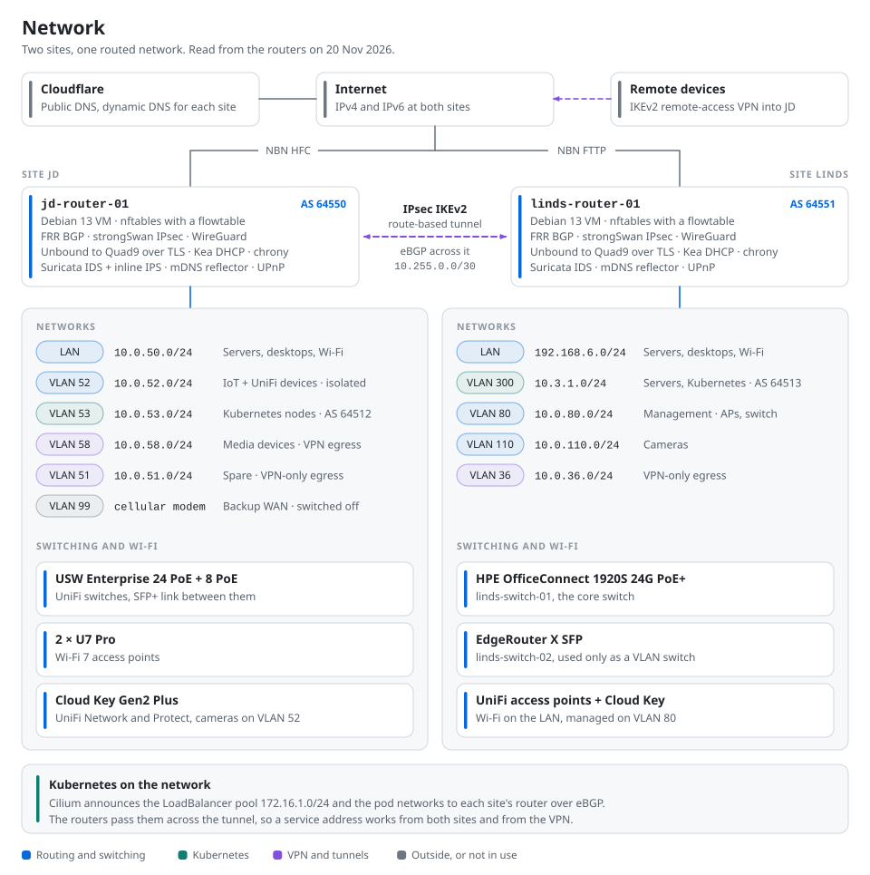
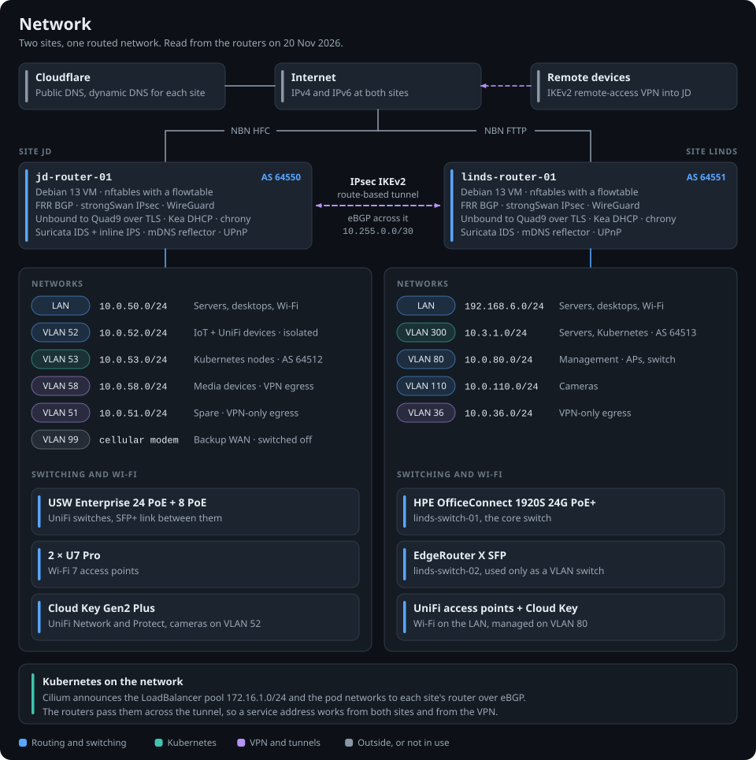
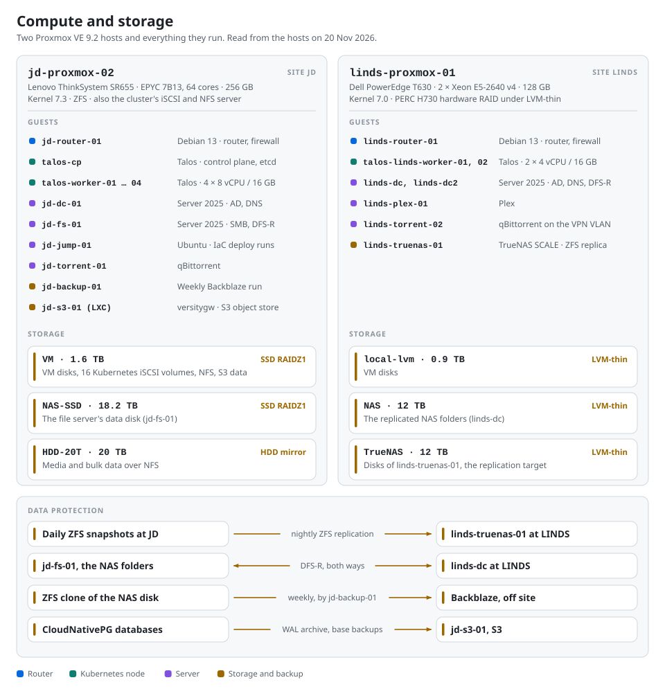
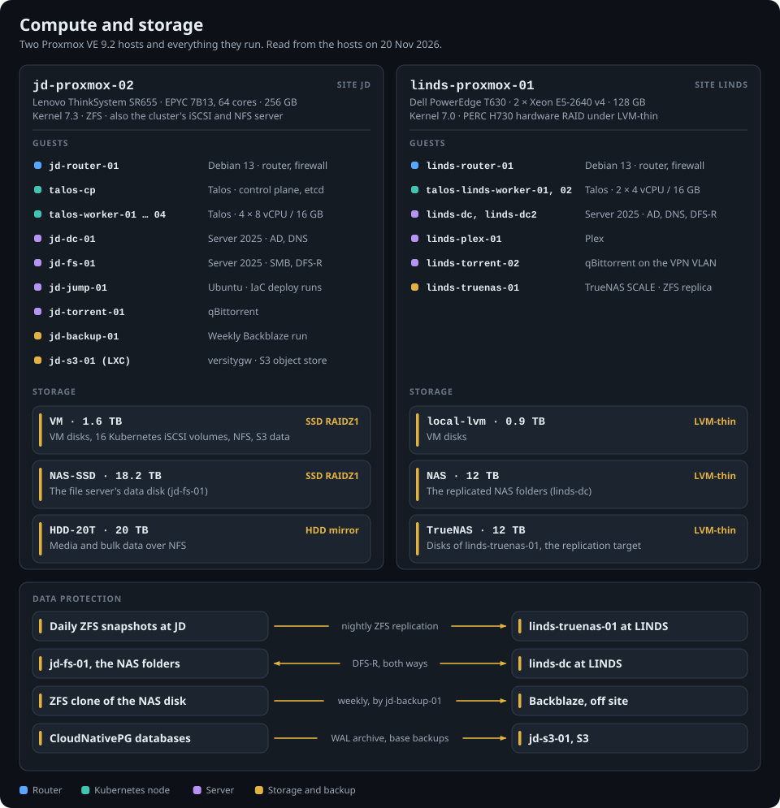
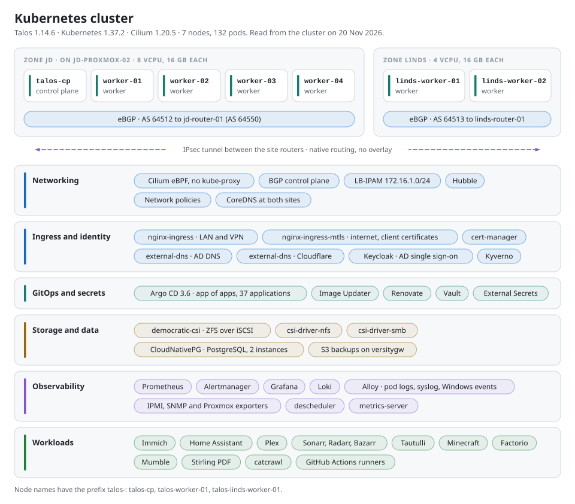
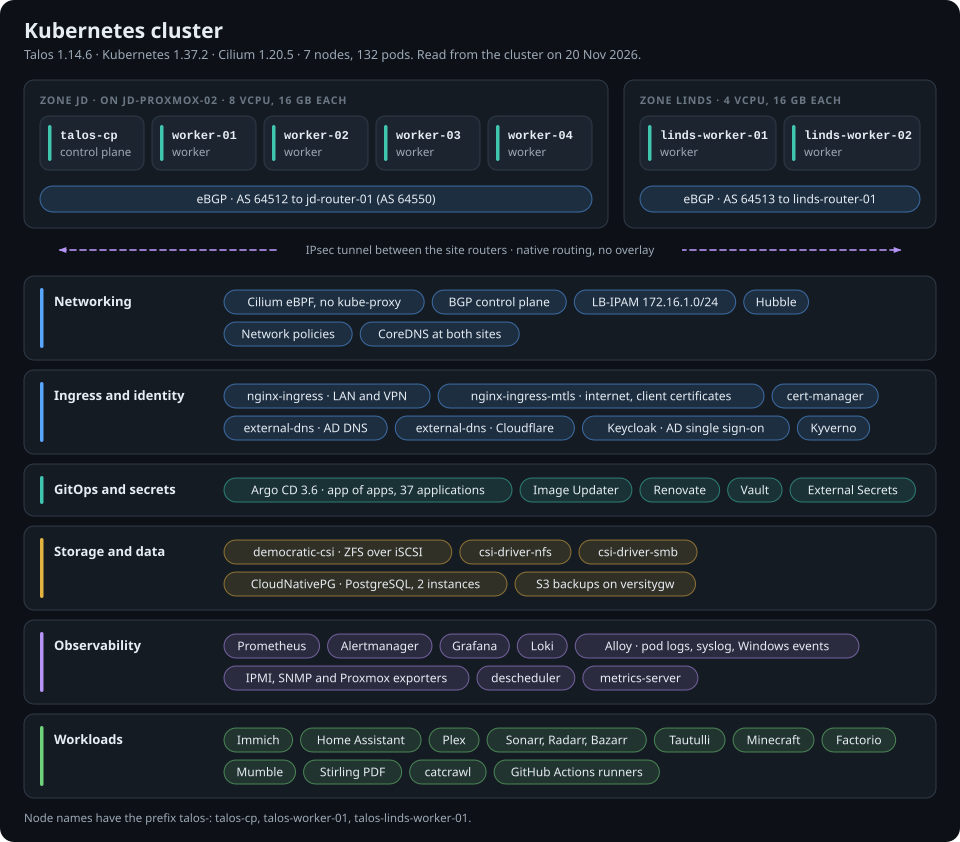
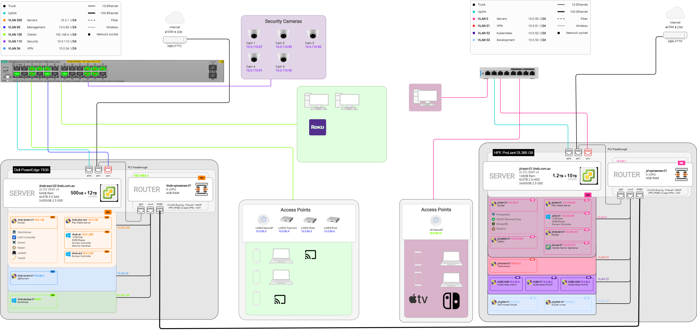
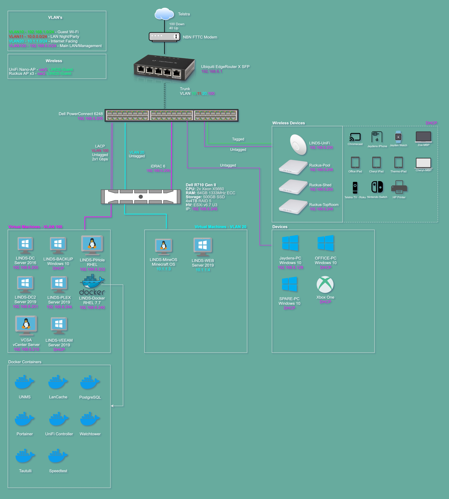

# November 2026 Update

Drawn from the live state of the lab on 20 November 2026. Full write-up: [Homelab, Late 2026: New Routers, New Storage, and Merge-to-Deploy]()

### Network

{: .light }
{: .dark }

Each site has a Debian 13 router VM (`jd-router-01`, `linds-router-01`) built by one Ansible role: nftables, FRR, strongSwan, Unbound, Kea, chrony, Suricata and an mDNS reflector. The routers hold an IKEv2 tunnel and exchange routes over eBGP (AS 64550 and AS 64551). The Kubernetes nodes of each site peer with their router (AS 64512 and AS 64513) and announce the LoadBalancer pool `172.16.1.0/24`.

| Site | Network | Subnet | Use |
|---|---|---|---|
| JD | LAN | `10.0.50.0/24` | Servers, desktops, Wi-Fi |
| JD | VLAN 52 | `10.0.52.0/24` | IoT and UniFi devices, isolated |
| JD | VLAN 53 | `10.0.53.0/24` | Kubernetes nodes |
| JD | VLAN 58 | `10.0.58.0/24` | Media devices, VPN egress |
| LINDS | LAN | `192.168.6.0/24` | Servers, desktops, Wi-Fi |
| LINDS | VLAN 300 | `10.3.1.0/24` | Servers, Kubernetes nodes |
| LINDS | VLAN 80 | `10.0.80.0/24` | Management: access points, switch |
| LINDS | VLAN 110 | `10.0.110.0/24` | Cameras |
| LINDS | VLAN 36 | `10.0.36.0/24` | VPN-only egress |

### Compute and storage

{: .light }
{: .dark }

**JD site:** Lenovo ThinkSystem SR655, AMD EPYC 7B13 (64 cores / 128 threads), 256GB RAM, Proxmox VE 9.2 on kernel 7.3. Three ZFS pools: `VM` (SSD RAIDZ1, 1.6TB), `NAS-SSD` (SSD RAIDZ1, 18.2TB) and `HDD-20T` (HDD mirror, 20TB). The host is also the iSCSI and NFS server for the cluster.

**LINDS site:** Dell PowerEdge T630, 2x Intel Xeon E5-2640 v4 (20 cores / 40 threads), 128GB RAM, Proxmox VE 9.2. PERC H730 hardware RAID under LVM-thin.

### Kubernetes ([LINDS-Kubernetes](https://github.com/Jayden-Lind/LINDS-Kubernetes))

{: .light }
{: .dark }

**Cluster:** 7 nodes (1 control plane + 4 workers at JD, 2 workers at LINDS), Talos v1.14.6, Kubernetes v1.37.2, Cilium 1.20.5, 37 Argo CD applications.

### How it is deployed

- [LINDS-Terraform](https://github.com/Jayden-Lind/LINDS-Terraform): the guests, the Packer templates (Ubuntu, Windows Server 2025), Talos and Cilium. Talos and Cilium changes apply from a timer every six hours.
- [LINDS-Ansible](https://github.com/Jayden-Lind/LINDS-Ansible): the routers, the Proxmox hosts, the Windows domain and file servers, the Linux VMs. A merge to `main` applies within about five minutes.
- [LINDS-Kubernetes](https://github.com/Jayden-Lind/LINDS-Kubernetes): Argo CD app of apps.
- Each pull request shows a preview of what a merge will apply. Renovate opens the version updates for all three repos.

## Changelog - March to November 2026

### Added
- jd-router-01, linds-router-01 (Debian 13 routers) 
- talos-worker-04 (Talos OS) 
- jd-s3-01 (versitygw S3 gateway, LXC) 
- jd-backup-01 (weekly Backblaze run of the NAS) 
- jd-dc-01, jd-fs-01, linds-dc, linds-dc2 rebuilt on Windows Server 2025 from a Packer template 
- democratic-csi (ZFS over iSCSI from the Proxmox host) 
- Keycloak (single sign-on from Active Directory), Kyverno, an mTLS-only ingress 
- Hardware, router and storage monitoring in Prometheus; Windows event logs and syslog in Loki 
- Suricata on both routers 
- Minecraft (Paper) 

### Removed
- JD-VyOS-01, LINDS-VyOS-01 (VyOS 1.5 rolling) 
- TrueNAS at JD (the host owns the ZFS pools now) 
- MinIO 
- Zabbix 
- Valheim 

# March 2026 Update

Full write-up: [Homelab 2026: Rebuilding the Stack from Bare Metal Up]()

### Hardware

Two physical sites running as a single Kubernetes cluster.

**JD site:** Lenovo ThinkSystem SR655, AMD EPYC 7B13 (64 cores / 128 threads), 256GB Samsung DDR4 ECC @ 2933 MT/s, Proxmox VE 9.2.3. Single-socket design with a single NUMA domain eliminates cross-socket memory latency entirely.

Storage (ZFS):
- `NAS-SSD`: RAIDZ1 across 5x Samsung 870 EVO 4TB SSDs (18.2TB usable, 11TB used). NFS/iSCSI backing for Kubernetes PVs.
- `VM`: RAIDZ1 across 3x mixed SSDs (1.62TB usable). VM disk pool.
- `HDD-20T`: Mirrored pair of 20TB Seagate enterprise HDDs (20TB usable, 8TB used). Cold and bulk storage.

**LINDS site:** Dell PowerEdge T630, 2x Intel Xeon E5-2640 v4 (20 cores / 40 threads, dual-socket NUMA), 128GB RAM, Proxmox VE 9.2.3. Storage via PERC H730 hardware RAID controller.

Both sites run Ubiquiti UniFi switching and APs, with VyOS 1.5 (rolling) handling routing, BGP, RA VPN, DNS/DHCP, and site-to-site IPSec.

### Terraform ([LINDS-Terraform](https://github.com/Jayden-Lind/LINDS-Terraform))

Terraform provisions everything from bare Proxmox hosts to a running Kubernetes cluster.

- **VM provisioning**: Uses the [bpg/proxmox](https://registry.terraform.io/providers/bpg/proxmox/latest) provider to create VMs across both sites. Packer builds golden images (Ubuntu 24.04, CentOS 9) that Terraform clones per host.
- **Talos cluster bootstrap**: Generates Talos machine secrets, applies node configs to each control plane and worker, bootstraps etcd, and writes `kubeconfig` + `talosconfig` locally. The cluster is 1 control plane + 3 workers at JD (AMD EPYC), 2 workers at LINDS (Intel Xeon), all running Talos v1.13.2 and Kubernetes v1.36.0.
- **Per-arch kernel tuning**: AMD and Intel nodes get separate Talos schematics with architecture-specific flags. Both disable all CPU vulnerability mitigations, set `transparent_hugepage=always`, pin the governor to `performance` (`amd_pstate=active` / `intel_pstate=active`), enable BBR congestion control, isolate RCU callbacks (`nohz_full`, `rcu_nocbs`), and apply tuned TCP buffer / conntrack sysctls.
- **Cilium via Helm**: Cilium is deployed into `kube-system` directly from Terraform after bootstrap. kube-proxy is disabled; Cilium's eBPF datapath handles all service routing with O(1) kernel hash map lookups.
- **BGP wiring**: Terraform applies `CiliumBGPClusterConfig` and `CiliumBGPPeerConfig` CRDs post-Cilium. JD nodes peer with VyOS at ASN 64512/64550; LINDS nodes at ASN 64513/64551. Cilium advertises the `172.16.1.0/24` LoadBalancer IP pool and pod CIDRs to VyOS, which redistributes them across both sites. No MetalLB.

### Ansible ([LINDS-Ansible](https://github.com/Jayden-Lind/LINDS-Ansible))

Handles all post-Terraform configuration for non-Talos hosts. 14 playbooks and roles:

- **VyOS**: Full router config via `vyos.vyos` collection. BGP peering, IPSec site-to-site VPN, RA VPN, DNS/DHCP, NAT, firewall. VyOS itself gets kernel-level tuning (`disable-mitigations`, `network-throughput` mode, TCP buffer sysctls).
- **TrueNAS**: NFS/iSCSI configuration for Kubernetes persistent volume backing.
- **General services**: Plex, Minecraft, torrent hosts, dev VMs, WSL setup.
- **Common baseline**: NTP, auto-updates, logrotate applied uniformly.

### Kubernetes ([LINDS-Kubernetes](https://github.com/Jayden-Lind/LINDS-Kubernetes))

All workloads managed via ArgoCD and Helm. The repo is ArgoCD `Application` manifests; reconciliation is fully automated. Rebuilding from scratch: `./app-deployment.sh` bootstraps ArgoCD, then it self-heals to the desired state.

**Cluster:** 6 nodes (1 control plane + 5 workers), Talos v1.13.2, Kubernetes v1.36.0, all nodes `Ready` for 157 days.

**Infrastructure layer**

| Component | Details |
|---|---|
| Cilium 1.19 | CNI, kube-proxy replacement, eBPF datapath, BGP control plane, Hubble flow observability |
| ArgoCD + image-updater | GitOps reconciliation; image-updater auto-bumps tags on new pushes |
| cert-manager | Automatic TLS via Let's Encrypt |
| Vault + external-secrets | Secrets management; external-secrets syncs Vault secrets into Kubernetes |
| external-dns | Syncs LoadBalancer/Ingress hostnames to internal DNS automatically |
| nginx-ingress | Ingress controller, running as a DaemonSet across all nodes |
| kube-prometheus stack | Prometheus, Grafana, AlertManager, node-exporter on all 6 nodes |
| Loki + Grafana Alloy | Log aggregation with pod log collection via Alloy |
| OpenTelemetry (OBI) | eBPF-based auto-instrumentation DaemonSet; traces service calls without code changes |
| CloudNativePG | PostgreSQL operator with barman-cloud continuous WAL archiving |
| csi-nfs + csi-smb | NFS/SMB CSI drivers backed by TrueNAS |
| GitHub Actions runners | Self-hosted runner controller (ARC) for homelab CI pipelines |
| kube-descheduler | Periodic pod rebalancing across nodes |

**Applications**

| App | Notes |
|---|---|
| Immich | Self-hosted photo management, 3 ML inference replicas with GPU acceleration |
| Home Assistant | Home automation |
| Plex | Media server |
| Factorio | Game server |
| Mumble | Self-hosted voice server |
| Catcrawl | Supermarket price scraper (personal project, runs CI via self-hosted runners) |
| Stirling PDF | Self-hosted PDF tooling |
| Zabbix | Infrastructure monitoring (server, web, Java gateway, agent on all nodes) |

## Changelog - 2023-2026
### Added to JD Site
- JD-proxmox-01 (LENOVO-SR655 - Proxmox VE 9.1.4) 
- JS-VyOS-01 (VyOS 1.5 rolling) 
- talos-cp-01 (Talos OS) 
- talos-worker-01 (Talos OS) 
- talos-worker-02 (Talos OS) 
- talos-worker-03 (Talos OS) 
- USW-Enterprise-24-PoE (Ubiquiti UniFi Switch Enterprise 24 PoE) 
- USW-Enterprise-8-PoE (Ubiquiti UniFi Switch Enterprise 8 PoE) 
- 2x Unifi-7-Pro-AP (Ubiquiti UniFi 7 Pro Access Point) 
- 3x Unifi G5 Flex Camera
- 1x Unifi G6 Turrent Camera
- Unifi Cloud Key Gen 2 Plus

### Added to LINDS Site
- LINDS-proxmox-01 (Dell T630 - Proxmox VE 9.1.4) 
- LINDS-VyOS-01 (VyOS 1.5 rolling) 
- talos-linds-worker-01 (Talos OS) 
- talos-linds-worker-02 (Talos OS) 
- 2x Unifi-6-AP (Ubiquiti UniFi 6 Access Point) 
- 3x Unifi G5 Flex Camera
- Unifi Cloud Key Gen 2 Plus

# 2022 Half Year Update:

There is a number of changes here, upgraded server, Dell R710 -> Dell T630, a new physical server, HPE DL360 G9, in a new location.

## Changelog - 2022 H2

### Added \>

- LINDS-OPNSense-01 (OPNSense 22.1) 
- HPE OfficeConnect 1920s 
- LINDS-ESXi-02 (Dell T630) 
- JD-ESXi-01 (HPE DL360 G9) 
- \> JD-DC-01 (Windows Server 2019) 
- \> JD-Dev-01 (CentOS 9 Stream) 
- \> JD-Zabbix-01 (CentOS 8 Stream) 
- \> JD-Plex-01 (CentOS 9 Stream) 
- \> JD-Docker-01 (CentOS 9 Stream) 
- \> JD-Torrent-01 (CentOS 8 Stream) 
- \> JD-VSCA-01 (vSphere Photon OS) 
- \> JD-Docker-01 (CentOS 9 Stream) 
- \> JD-OPNSense-01 (OPNSense 22.1) 
- \> JD-GitLab-01 (CentOS 8 Stream) 
- \> JD-GitLab-R01 (CentOS 8 Stream) 
- \> KUBE-ADM (CentOS 8 Stream) 
- \> KUBE-01 (CentOS 8 Stream) 
- \> KUBE-02 (CentOS 8 Stream) 

### Removed \<

-  \< LINDS-PiHole 
-  \< LINDS-ERx (UBIQUITI EDGEROUTER X) 
-  \< LINDS-Plex (Windows Server 2019) 
-  \< LINDS-Veeam (Windows Server 2019) 
-  \< LINDS-Web (Windows Server 2019) 
-  \< LINDS-MineOS (Turnkey MineOS) 
-  \< Dell PowerConnect 6248 
-  \< LINDS-VSCA (vSphere Photon OS) 

# 2020 Update:

<h2>Virtual Machines</h2>

<strong>LINDS-DC</strong> - Domain Controller, DNS, File Shares, Certificate Authority - Server 2016 <strong>LINDS-DC2</strong> - Domain Controller, DNS, Windows Deployment Services - Server 2019 <strong>LINDS-PLEX</strong> - Plex Server - Server 2019 <strong>LINDS-PiHole</strong> - DNS, Adblocking - CentOS 7 <strong>LINDS-Backup</strong> - Backblaze client to backup the 12TB stored on LINDS-DC - Windows 10 <strong>LINDS-MineOS</strong> - 4 Minecraft servers- Turnkey Linux <strong>LINDS-WEB</strong> - IIS (hosting this website) - Server 2019 <strong>LINDS-Docker</strong> - Docker host that runs around 20 containers, which include UniFi controller, UNMS, Monolithic LanCache, PostgreSQL server - Red Hat Enterprise Linux <strong>LINDS-VEEAM</strong> - Veeam server, backups all servers except LINDS-DC due to RDM (Raw Device Mapping) being utilised <strong>VCSA</strong> - vCenter Server Appliance 6.7

